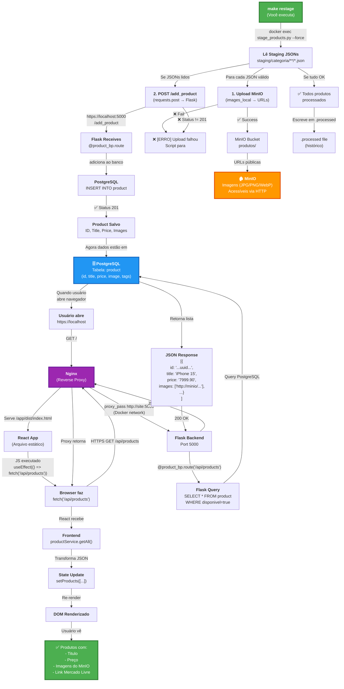

# 📊 Visão Completa: Fluxo de Dados (Restage → Nginx → React)



---

## 🔍 Detalhes de Cada Etapa

### 📦 **Etapa 1: Staging → MinIO + PostgreSQL** (make restage)

```python
# services/site/scripts/stage_products.py

for json_file in staging_files:
    data = json.read(json_file)
    
    # Etapa 1.1: Upload de imagens
    local_images = data["images_local"]  # ["/uploads/iphone/img1.jpg", ...]
    urls = upload_images("produtos", local_images)
    # MinIO: produtos/iphone-15/20260328_103522_img1.jpg
    #        ↓ Retorna URL pública
    # data["images"] = ["http://minio:9000/produtos/iphone-15/...", ...]
    
    # Etapa 1.2: POST para Flask /add_product
    payload = {
        "title": data["title"],
        "price": data["price"],           # String como "7999.90"
        "oldPrice": data["oldPrice"],
        "images": urls,                   # URLs do MinIO
        "link": data["link"],
        "tag": data["tag"],               # "eletrônicos"
        "subcategory": data["subcategory"], # "smartphones"
        "external_id": data["external_id"],
        "platform": "mercadolivre"
    }
    
    resp = requests.post(
        "https://localhost:5000/add_product",
        json=payload,
        verify=False  # Self-signed cert
    )
    
    if resp.status_code == 201:
        print(f"✅ Produto salvo: {data['title']}")
    else:
        print(f"❌ Erro {resp.status_code}: {resp.text}")
```

### 🔌 **Etapa 2: Flask Recebe → Salva BD**

```python
# services/site/routes/product_routes.py :: /add_product

@product_bp.route("/add_product", methods=["POST"])
def add_product():
    data = request.json
    
    # Valida campos obrigatórios
    required_fields = ["title", "price", "oldPrice", "images", "link"]
    if not all(field in data for field in required_fields):
        return {"error": "Campos obrigatórios faltando"}, 400
    
    # Categoriza automaticamente se não houver tag
    tags = ["geral", data.get("tag", "")]  # ["geral", "eletrônicos"]
    
    # Salva no banco
    product = save_product(
        title=data["title"],                    # "iPhone 15"
        price=float(data["price"]),             # 7999.90
        old_price=float(data["oldPrice"]),      # 9999.00
        image=json.dumps(data["images"]),       # JSON: ["http://minio/..."]
        link=data["link"],
        tags=json.dumps(tags),                  # JSON: ["geral", "eletrônicos"]
        subcategory=data.get("subcategory", ""),
        external_id=data.get("external_id", ""),
        disponivel=data.get("disponivel", True)
    )
    
    # INSERT INTO product (id, title, price, image, link, tags, ...)
    # VALUES ('550e8400-...', 'iPhone 15', 7999.9, '["http://..."]', ...)
    
    return {
        "message": "Produto salvo com sucesso!",
        "product": product.to_dict()
    }, 201
```

**Resultado no PostgreSQL**:
```sql
SELECT * FROM product WHERE title LIKE 'iPhone%';

┌──────────────────────────┬─────────────┬──────────┬────────────────────────────────┬──────────┐
│ id                       │ title       │ price    │ image                          │ tags     │
├──────────────────────────┼─────────────┼──────────┼────────────────────────────────┼──────────┤
│ 550e8400-e29b-41d4-a... │ iPhone 15   │ 7999.90  │ ["http://minio:9000/...","...] │ ["..."]  │
└──────────────────────────┴─────────────┴──────────┴────────────────────────────────┴──────────┘
```

---

### 🌐 **Etapa 3: Nginx Reverse Proxy + React**

#### 3.1 User abre `https://localhost`

```nginx
# nginx-react.conf

server {
    listen 443 ssl http2;
    server_name localhost;
    
    root /app/dist;  # ← React compilado (frontend/dist)
    
    # Serve index.html
    location / {
        try_files $uri /index.html;
    }
    
    # Proxia API para Flask
    location /api/ {
        proxy_pass http://flask_backend;  # = http://site:5000
        proxy_set_header Host $host;
        proxy_set_header X-Real-IP $remote_addr;
        proxy_set_header X-Forwarded-Proto https;
    }
}
```

**Request/Response**:
```
Browser→Nginx:
  GET / HTTP/1.1
  Host: localhost
  
Nginx←Browser:
  HTTP/1.1 200 OK
  Content-Type: text/html
  
  <!DOCTYPE html>
  <html>
  <body>
    <div id="root"></div>
    <script src="/js/index.tsx-...js"></script>
  </body>
  </html>
```

#### 3.2 React JS executa

```typescript
// frontend/src/pages/Home.tsx

export default function Home() {
  const [products, setProducts] = useState<Product[]>([])
  
  useEffect(() => {
    productService.getAll()
      .then(data => {
        console.log(`✅ Carregou ${data.length} produtos`)
        setProducts(data)
      })
      .catch(err => console.error('❌ Erro:', err))
  }, [])
  
  return (
    <div>
      {products.map(p => (
        <ProductCard key={p.id} product={p} />  // Renderiza cada produto
      ))}
    </div>
  )
}
```

#### 3.3 fetch('/api/products')

```typescript
// frontend/src/services/productService.ts

async getAll(params?: SearchParams): Promise<Product[]> {
  console.log('🔄 [productService] Fetching /api/products...')
  
  const response = await api.get<ApiProduct[]>('/api/products', { params })
  // Como api = axios.create({
  //   baseURL: 'http://localhost:5000'  // ← Durante vite dev
  //   // Ou baseURL = '' durante production (servidor serve React)
  // })
  
  console.log(`✅ [productService] Received ${response.data.length} raw products`)
  
  const transformed = response.data.map(product => transformProduct(product))
  return transformed
}
```

#### 3.4 Nginx Proxy → Flask

```
Browser: GET /api/products HTTPS
    ↓
Nginx (puerto 443)
    ├─ Decifra HTTPS (self-signed cert)
    ├─ Vê que é /api/*
    ├─ Procura "upstream flask_backend"
    ├─ Resolve DNS: "site:5000" → 172.18.0.2:5000 (rede Docker)
    └─ Faz: GET http://site:5000/api/products HTTP/1.1
             Host: localhost
             X-Real-IP: 127.0.0.1
             X-Forwarded-Proto: https
```

#### 3.5 Flask Query + Response

```python
# Flask (site:5000)

@product_bp.route("/api/products")
def api_products():
    tag = request.args.get('tag', 'all')
    search = request.args.get('search', '').strip()
    
    if search:
        products = Product.query.filter(
            Product.title.ilike(f'%{search}%')
        ).all()
    elif tag == 'all':
        products = db.session.query(Product).all()
    else:
        products = Product.query.filter(
            Product.tags.contains(f'"{tag}"')
        ).all()
    
    return jsonify([p.to_dict() for p in products])

# p.to_dict() retorna:
# {
#   "id": "550e8400-...",
#   "title": "iPhone 15",
#   "price": "7999.90",
#   "image": ["http://minio:9000/produtos/iphone-15/...jpg", ...],
#   "tags": ["geral", "eletrônicos"],
#   "disponivel": True,
#   "link": "https://mercadolivre.com.br/...",
#   ...
# }
```

#### 3.6 JSON volta via Nginx

```
Flask (localhost:5000): HTTP/1.1 200 OK
    [{"id":"...", "title":"iPhone", "price":"7999.90", "images":[...], ...}]
        ↓
Nginx (porta 443)
    └─ proxy_buffering on → armazena resposta
    └─ Encripta com HTTPS
    └─ Envia ao Browser
        ↓
Browser: HTTPS Response
    ├─ Status: 200
    ├─ Content-Type: application/json
    └─ Body: [{"id":"...", ...}]
        ↓
React JS
    ├─ JSON.parse(response)
    ├─ setProducts([{...}, {...}])  // ← State update
    └─ Re-render → <ProductCard>
```

---

## 🎯 Fluxo Resumido em 4 passos

```
┌───────────────────────────────────────────────────────────────────┐
│ PASSO 1: make restage                                             │
├───────────────────────────────────────────────────────────────────┤
│ staging/*.json → MinIO (imagens) + PostgreSQL (metadata)          │
│ Resultado: Database tem produtos, MinIO tem fotos                 │
└───────────────────────────────────────────────────────────────────┘
                              ↓
┌───────────────────────────────────────────────────────────────────┐
│ PASSO 2: Docker services UP                                       │
├───────────────────────────────────────────────────────────────────┤
│ Flask (5000) + Nginx (443) + PostgreSQL (5432) + MinIO (9000)    │
│ Resultado: Todos containers rodando e conectados                  │
└───────────────────────────────────────────────────────────────────┘
                              ↓
┌───────────────────────────────────────────────────────────────────┐
│ PASSO 3: Browser @ https://localhost                              │
├───────────────────────────────────────────────────────────────────┤
│ Nginx serve React.js (arquivo index.html + JS/CSS compilados)    │
│ Resultado: React App carregado no navegador                       │
└───────────────────────────────────────────────────────────────────┘
                              ↓
┌───────────────────────────────────────────────────────────────────┐
│ PASSO 4: React faz fetch('/api/products')                        │
├───────────────────────────────────────────────────────────────────┤
│ Browser → Nginx (proxeia) → Flask (queries DB) → Nginx → Browser │
│ React renderiza: <ProductCard title="iPhone" price="7999.90"/> │
│ Resultado: Produtos aparecem na tela! ✅                         │
└───────────────────────────────────────────────────────────────────┘
```

---

## ⚠️ Erro Comum & Solução

### ❌ "Corri restage, mas React não mostra produtos"

**Diagnóstico**:
1. ✅ `make psql` → `SELECT COUNT(*) FROM product` = 42 (produtos lá)
2. ❌ Browser abre https://localhost mas **não mostra nenhum produto**
3. ❌ DevTools → Console → Vê erro de rede

**Causa mais comum**:
- React foi buildiado ANTES do `restage`
- Browser tem cache do antigo build
- React nunca chamou `/api/products`

**Solução**:
```bash
# 1. Rebuild React
cd frontend && npm run build

# 2. Reinicia Nginx (para servir novo build)
docker compose -f docker-compose.react.yaml restart nginx

# 3. Hardrefresh no navegador
# Ctrl+Shift+R (Windows/Linux) ou Cmd+Shift+R (Mac)

# 4. Espera 2-3s e pronto!
```

---

## 📋 Checklist de Confirmação

Depois que tudo funcionar, verifica isto para garantir:

- [ ] PostgreSQL tem dados: `make psql` → `SELECT COUNT(*) FROM product;` > 0
- [ ] MinIO tem imagens: Buckets "produtos", "fallbacks" existem
- [ ] Nginx serve React: `curl -k https://localhost/ | grep -q index.html`
- [ ] Proxy funciona: `curl -k https://localhost/api/products | jq '.[0].title'`
- [ ] Firebase/Redux atualiza: Abre DevTools → Console → sem erros vermelho
- [ ] Produtos aparecem: Cada card mostra título, preço, imagem

**SE TUDO VERDADEIRO**: Arquitetura está 100% funcional! 🎉
