# 🎯 Resposta Rápida: "Não foi para o site do Nginx"

## Sua Pergunta → Resposta Direta

### **1️⃣ O que `make restage` faz?**

```bash
make restage
# ↓ Executa:
docker exec -it site python3 scripts/stage_products.py --force
```

**Etapas:**
1. **Lê JSONs** do `staging/categoria/subcategoria/*.json`
2. **Upload imagens** para MinIO (local path → URL pública)
3. **POST `/add_product`** para Flask (payload com URLs + metadata)
4. **PostgreSQL** salva produtos no banco

**Flag `--force`**: Ignora `.processed` e reprocessa TODOS os JSONs (não apenas novos)

---

### **2️⃣ Comando publica dados em MinIO ou banco?**

**AMBOS!**

| Local | O que vai | Como chega |
|-------|----------|-----------|
| **MinIO** | Imagens (JPG/PNG/WebP) | via `minio_client.fput_object()` |
| **PostgreSQL** | Metadados (title, price, tags, URLs) | via POST → Flask → INSERT |

```
staging/iphone-15.json
  ├─ images_local: ["/uploads/iphone/img1.jpg", ...]
  │   ↓ upload_images()
  │   └─ MinIO: "produtos/iphone-15/20260328_img1.jpg"
  │   └─ Gera URL: "http://minio:9000/produtos/..."
  │
  └─ POST /add_product {
      title: "iPhone 15",
      price: "7999.90",
      images: ["http://minio:9000/..."],  // ← URLs do MinIO
      link: "https://mercadolivre.com.br/...",
      ...
    }
    ↓
    PostgreSQL.product (id, title, price, image, tags, ...)
```

---

### **3️⃣ Como Nginx acessa esses dados?**

```
React App (navegador)
  ↓
fetch('/api/products')
  ↓
Nginx (port 443)
  ├─ Reconhece: "/api/*"
  ├─ Vê "upstream flask_backend"
  ├─ Proxeia para "http://site:5000"
  ↓
Flask Backend (port 5000)
  ├─ Route: @product_bp.route('/api/products')
  ├─ Query: SELECT * FROM product WHERE disponivel=true
  ├─ PostgreSQL retorna dados
  ├─ JSON.dumps([{title, price, images, ...}])
  ↓
Nginx
  ├─ Recebe resposta
  ├─ Retorna para browser
  ↓
React
  ├─ JSON.parse()
  ├─ setProducts([...])
  ├─ Re-render: <ProductCard/>
  ↓
✅ Usuário vê produtos na tela
```

---

### **4️⃣ Qual é o fluxo esperado?**

```mermaid
graph LR
    A["1. restage<br/>Dados → DB + MinIO"] -->
    B["2. Docker UP<br/>Flask (5000)<br/>Nginx (443)<br/>PostgreSQL (5432)<br/>MinIO (9000)"] -->
    C["3. Browser open<br/>https://localhost"] -->
    D["4. Nginx serve<br/>React index.html<br/>from /app/dist/"] -->
    E["5. React fetch<br/>fetch('/api/products')"] -->
    F["6. Nginx proxy<br/>→ site:5000"] -->
    G["7. Flask query DB<br/>SELECT * FROM product"] -->
    H["8. JSON return<br/>[{id, title, price,<br/>images, ...}]"] -->
    I["9. React render<br/><ProductCard/>"] -->
    J["✅ Products appear<br/>on screen"]
    
    style A fill:#4CAF50,color:#fff
    style H fill:#2196F3,color:#fff
    style J fill:#4CAF50,color:#fff
```



---

## ❌ Problema: "Não foi para o site"

### O que isso significa?

```
Dev executou: make restage
Resultado esperado: Novos produtos aparecem em https://localhost
Resultado real: Nada mudou na UI
```

### Possíveis Causas & Testes

| # | Causa | Teste | Solução |
|---|-------|-------|---------|
| **1** | Banco vazio (restage falhou) | `make psql`<br/>`SELECT COUNT(*) FROM product;` | `make restage` |
| **2** | Nginx não serve React build | `curl -k https://localhost/ \| head` | `npm run build`<br/>`docker-compose up -d` |
| **3** | Flask não responde | `docker exec -it site curl https://localhost:5000/api/products` | `make restart-site` |
| **4** | Proxy não funciona | `curl -k https://localhost/api/products` | `docker network inspect backend` |
| **5** | React em cache velho | Browser DevTools → Network → `/api/products` | Ctrl+Shift+R (hardrefresh) |

---

## ✅ Checklist de Validação

Execute isto sequencialmente:

```bash
# 1. Verifica se banco tem dados
docker exec -it postgres-dev psql -U user -d produtos_db -c \
  "SELECT COUNT(*) as total FROM product;"

# 2. Verifica se MinIO tem buckets
docker exec -it site python3 -c \
  "from minio import Minio; c = Minio('minio:9000', 'minio', 'minio123', secure=False); print([b.name for b in c.list_buckets()])"

# 3. Verifica se Flask responde
docker exec -it site curl -k https://localhost:5000/api/products | jq '.[0]'

# 4. Verifica se Nginx proxeia
curl -k https://localhost/api/products 2>&1 | jq '.[0]'

# 5. Verifica React build
ls -la frontend/dist/ | wc -l  # Deve return > 5

# 6. Se tudo OK, testa no navegador
open https://localhost
# DevTools F12 → Console → sem erros vermelho
# DevTools Network tab → /api/products → Status 200
```

**Se todos os testes passam ✅ mas produtos não aparecem:**
- Hardrefresh: `Ctrl+Shift+R` (Windows/Linux) ou `Cmd+Shift+R` (Mac)
- Ou: Limpar cache do navegador (F12 → Settings → Clear browsing data)

---

## 📄 Documentação Completa

Para troubleshooting detalhado, veja:

1. **[DIAGNOSTICO_RESTAGE_NGINX.md](DIAGNOSTICO_RESTAGE_NGINX.md)**
   - Explicação completa do fluxo
   - 4 problemas comuns + soluções
   - Arquitetura visual

2. **[DEBUG_RESTAGE_QUICK.md](DEBUG_RESTAGE_QUICK.md)**
   - 8 testes rápidos (copy-paste)
   - Mapa de debug visual
   - Solução nuclear (reset completo)

3. **[FLUXO_DADOS_VISUAL.md](FLUXO_DADOS_VISUAL.md)**
   - Diagrama Mermaid do fluxo
   - Código-fonte de cada etapa
   - Exemplo real de requisição/resposta

---

## 🔧 Comando Rápido (se tudo falhar)

```bash
# Reset nuclear de 5 minutos
make down && \
docker volume prune -f && \
docker compose -f docker-compose.yaml -f docker-compose.dev.yaml up -d --build && \
sleep 20 && \
make restage && \
docker compose -f docker-compose.yaml -f docker-compose.react.yaml up -d && \
echo "✅ Done! Open: https://localhost"
```

---

## 🎓 Resumo Técnico

| Componente | Responsabilidade | Status |
|------------|------------------|--------|
| **`make restage`** | Ler JSONs, upload MinIO, POST `/add_product` | ✅ (Funciona se `/add_product` tá UP) |
| **PostgreSQL** | Armazena metadata de produtos | ✅ (Verifica com `make psql`) |
| **MinIO** | Armazena imagens com URLs públicas | ✅ (Verifica com `docker exec ... curl http://minio`) |
| **Flask** | Route `/api/products` retorna JSON do banco | ✅ (Verifica com `curl localhost:5000/api/products`) |
| **Nginx** | Serve React estático + proxeia /api/* | ✅ (Verifica com `curl https://localhost/api/products`) |
| **React** | Fetch `/api/products`, renderiza cards | ✅ (Verifica com DevTools Console) |

**Se todos os "Verifica" passam, arquitetura está 100% OK!** 🎉

---

## 💡 TL;DR

```
Q: "Não foi para o site do Nginx"
R: Significa que dados NÃO apareceram após restage

Isso pode ser:
1. Restage rodar mas NÃO salvar no BD → Ver logs
2. Banco ter dados mas Nginx não proxiar → Test proxy
3. Proxy funcionar mas React em cache → Hardrefresh (Ctrl+Shift+R)

Solução 99%: npm run build + hardrefresh
Solução 100%: make down && ... && make up (ver acima)
```
